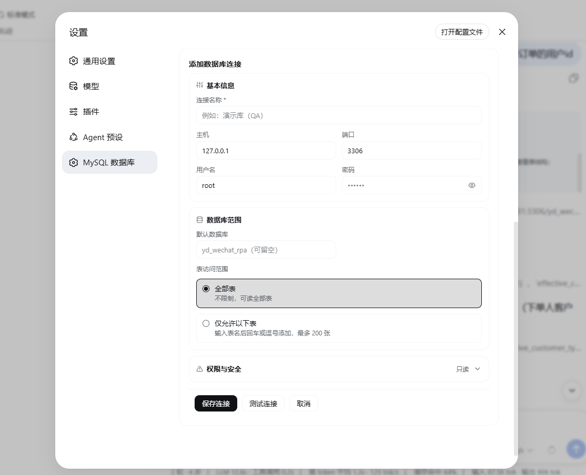
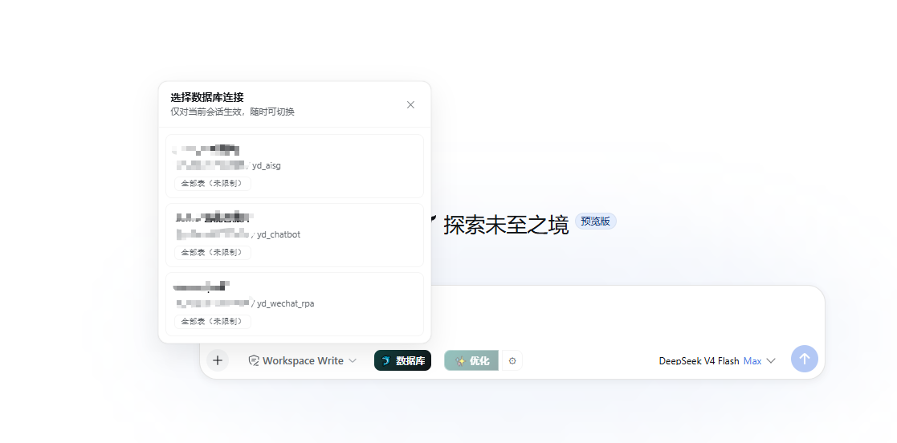

# dsh-mysql

[English](README.md) | 中文

DeepSeek Harness 的 MySQL 连接插件：在 DSH 设置页配置多套 MySQL 连接——每套带**可读表白名单**与**写权限开关**（默认关闭）——再通过输入栏左侧的数据库连接按钮为当前会话切换连接。所有 Agent 预设立即获得 `mysql_query` / `mysql_tables` / `mysql_execute` 工具，无需修改任何预设。

- **设置页**（`设置 → MySQL 数据库`）：增 / 删 / 改 / 测试连接——主机、端口、账号、密码、默认库，每连接可配**可读表白名单**与**写权限**（默认关闭）。
- **输入栏按钮**（数据库图标，输入框左侧）：为**当前会话**选择连接，随时切换。选中的连接与其可读表会追加进每轮的运行时上下文快照，模型天然知道当前该查哪个库——用于上下文缓存的稳定系统提示词前缀不会被改写。
- **全局工具**（所有 Agent 预设下都可用）：

| 工具 | 用途 |
| --- | --- |
| `mysql_query` | 对选中连接执行只读单语句 `SELECT/SHOW/DESCRIBE/EXPLAIN`。强制表白名单、拒绝多语句、`SELECT` 自动注入 `MAX_EXECUTION_TIME` 提示、最多返回 `2000` 行并带 `truncated` 标记。 |
| `mysql_tables` | 通过 `information_schema` 查看可读表结构（表、列、类型、键、注释）。 |
| `mysql_execute` | 仅 `INSERT/UPDATE/DELETE`，且仅当连接开启**允许写操作**时可用（默认关）。DDL（`DROP/TRUNCATE/ALTER` 等）与多语句一律拒绝。 |

- 会话级选择通过工具执行上下文（`exec.agent`）解析，模型永远查询用户在输入栏选中的那个库。
- 连接信息保存在本机 `$DSH_HOME/storages/dsh-mysql/connections.json`；密码只存在本机，绝不回传给浏览器（界面只看到 `hasPassword`）。

## 安装

```powershell
dsh plugin --profile web add github:1321928757/dsh-mysql#v0.1.10
```

或从 npm 安装（发布后可用）：

```powershell
dsh plugin --profile web add dsh-mysql
```

PowerShell 一键安装（自动准备固定版本 pnpm、锁定版本、自检）：

```powershell
irm https://raw.githubusercontent.com/1321928757/dsh-mysql/v0.1.10/scripts/install.ps1 | iex
```

然后**重启** `dsh web`（确认旧进程真的退出）。重启后打开 `设置 → MySQL 数据库` 添加连接并点「测试连接」；输入栏左侧会出现数据库连接按钮。验证安装：

```powershell
dsh --profile web --dump-config | findstr dsh-mysql
```

卸载：`dsh plugin --profile web remove dsh-mysql`

> 环境要求：DeepSeek Harness（Node ≥ 20）。插件自带预构建 JS（依赖 `mysql2`、`zod`），git 源安装无需构建授权。连接信息仅存本机，不会离开你的机器。

## 快速上手

1. 打开 **设置 → MySQL 数据库** → `+ 添加连接`，填写主机 / 端口 / 账号 / 密码 / 默认库，可选填可读表白名单（逗号分隔），决定是否开启写权限；点「测试连接」通过后「保存」。
2. 在任意会话中，点击输入框左侧的数据库连接按钮，选择一个连接（仅当前会话生效；只配置一个连接时会自动选中）。
3. 直接向 Agent 提问数据库相关的问题——它会先用 `mysql_tables` 看结构、再用 `mysql_query` 查数据；连接开启写权限后，`mysql_execute` 可执行 `INSERT/UPDATE/DELETE`。

## 截图

设置页——连接卡片（白名单表标签、只读/可写徽标）：



从输入栏数据库连接按钮展开的会话级连接选择器：



Agent 在会话中调用 `mysql_query` 查询数据库的结果：


## 安全模型

- 工具层拦截，纵深防御。生产环境建议同时为 Agent 创建权限最小化的专用 MySQL 账号（理想情况只有 `SELECT`）。
- `mysql_query` 只接受单条 `SELECT/SHOW/DESCRIBE/EXPLAIN`；`mysql_execute` 只接受单条 `INSERT/UPDATE/DELETE` 且要求连接显式开启 `allowWrite`。
- 表白名单：连接配置了表列表后，所有语句都会校验，引用白名单外的表即拒绝（留空 = 不限制，可读全部表）。
- `SELECT` 自动注入 `MAX_EXECUTION_TIME(15000)` 优化器提示；结果集封顶 2000 行；多语句与 DDL 一律拒绝。
- 密码明文保存在本机 `$DSH_HOME/storages/dsh-mysql/connections.json`，请用文件权限 / 专用系统账号保护。

## 工作原理

- **Host 半**（`lib/index.js`）：懒加载 mysql2 连接池（配置变更自动重建）、会话级选择映射、三个全局工具、追加在对话尾部的 `systemPrompt.context` 动态上下文，以及经 `remote.mysql.*` Typert RPC 暴露给浏览器的 `mysql` 服务（连接增删改查 / 测试 / 选择 / 表列表）。
- **浏览器半**（`lib/client.js`）：`conversation.input.left` 槽位承载数据库连接按钮与选择面板；`settings.section` 槽位（id `mysql`）承载连接配置页。所有 UI 消费 `--dsw-*` 主题令牌，跟随全局亮/暗主题。

## 从「预设内嵌 mysql 工具」迁移

如果你的预设此前内嵌了 `mysql_query`/`mysql_execute`（例如一行加载本地 `mysql-tool.mjs`）：

1. 把本插件装进 profile；
2. 从预设的 `agent.cordis.yml` 中删除 mysql 工具行与连接配置（保留业务 persona 文案）；
3. 重启 `dsh web`，再到 **设置 → MySQL 数据库** 重建连接。工具名完全一致，预设提示词里提到 `mysql_query` 的内容无需改动。

## 开发

```powershell
node --check lib\index.js lib\shared.js lib\typert.host.js lib\client.js
node test\shared.test.mjs
pnpm pack
dsh plugin --profile web add .\dsh-mysql-0.1.10.tgz
# 重启 dsh web，浏览器验收
```

## License

[MIT](LICENSE)。与 DeepSeek 无关联。安装即在本机运行第三方代码——请先审阅源码。